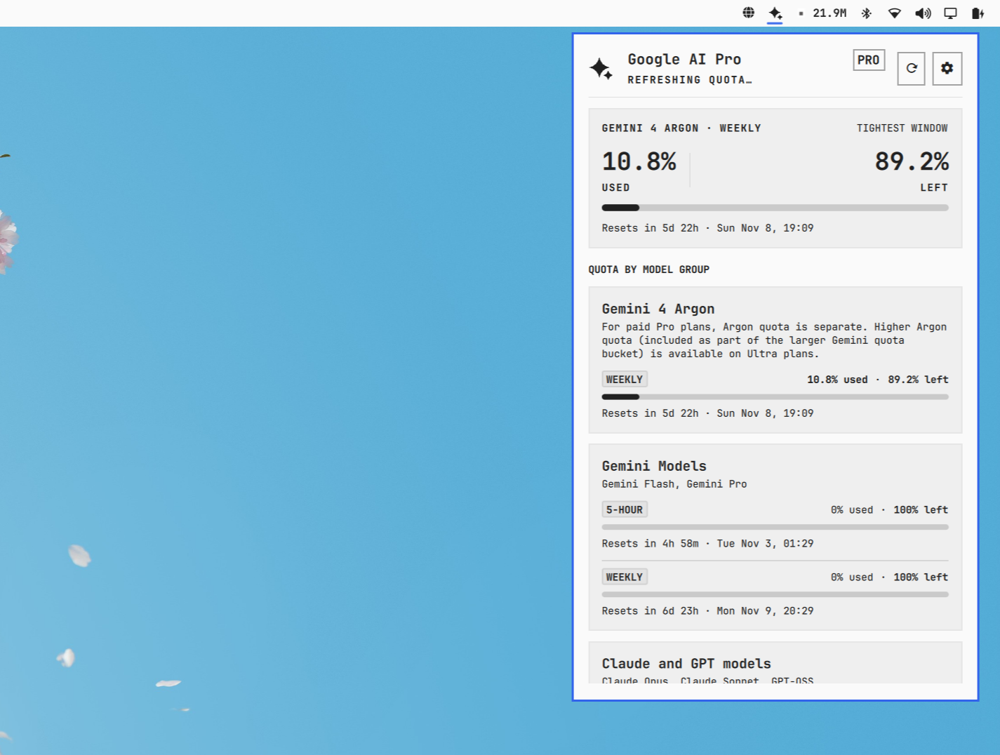

# Antigravity Quota

**Your Google AI plan, in your Omarchy bar.** Shows how much of your Antigravity quota you have used and how much is left, per model group and time window, plus your AI credits and your local CLI token usage.



## What it does

- Adds a Google AI sparkle icon to the bar. The icon changes color when your quota is running low (accent color at your warning threshold, red at 90% used).
- Left-click opens a panel. It shows a big used/left pair for the tightest quota window, and a card for each model group (`Gemini Models`, `Gemini 4 Argon`, `Claude and GPT models`) with a meter bar, used and remaining percent, and when the limit resets.
- Shows your Google AI plan tier (Pro, Ultra or Free) and your remaining AI credits, with a link to the credits portal.
- Shows how many tokens and prompts your local `agy` CLI sessions used today and over the last 7 days, read from the transcripts on your disk.
- Refreshes by itself every 5 minutes. You can also refresh by pressing `r`, middle-clicking the icon, or using `omarchy-shell ... refresh`.
- The icon can show a percentage on the bar (`% left`, `% used`, or both), set in the plugin's settings view.


## Install

Antigravity Quota needs the [Antigravity CLI](https://antigravity.google) (`agy`), signed in to your Google AI account. It finds `agy` on `PATH`, in `~/.local/bin`, `~/.gemini/antigravity-cli/bin`, `/usr/local/bin` or `/usr/bin`; set **Antigravity CLI path** in the widget's settings if yours is elsewhere. Python needs no extra package — it ships with every Omarchy install.

```
omarchy plugin add https://github.com/Nonlinearsound/antigravity-quota.git
```

The sparkle lands in the bar's right section; drag it anywhere on the bar.

### Uninstall

```
omarchy plugin remove nonlinearsound.omarchy-plugin-antigravity-quota
rm -rf ~/.cache/omarchy/antigravity-quota
```

Antigravity Quota changes nothing in Antigravity's own settings, and nothing else to clean up.

### Keys

| Key | Does |
| --- | --- |
| `j` `k` / arrows | Scroll the panel |
| `r` / `Enter` | Refresh the quota |
| `s` | Open settings (save again with `s`) |
| `c` | Open the Google AI credits portal |
| `Tab` | Next bar panel |
| `Esc` | Back out of settings, then close |

On the bar icon: left-click toggles the panel, middle-click forces a refresh, right-click opens the settings view.

Antigravity Quota answers over IPC, so you can bind it in `~/.config/hypr/bindings.lua`:

```
omarchy-shell nonlinearsound.omarchy-plugin-antigravity-quota toggle
omarchy-shell nonlinearsound.omarchy-plugin-antigravity-quota refresh
omarchy-shell nonlinearsound.omarchy-plugin-antigravity-quota settings
```

## Settings

Widget settings are saved into your `~/.config/omarchy/shell.json`, attached to the bar-layout entry by plugin ID. Both the panel's settings view (`right-click` or `s`) and `omarchy plugin` tooling write there; removing the plugin removes the entry with it.

| Setting | Default |
| --- | --- |
| Bar display | Icon only (or `% left`, `% used`, `used · left`) |
| Meter style | Fill upward with `% used` (or drain downward with `% left`) |
| Warning threshold | 80% used (accent color; urgent at 90%) |
| Refresh interval | 300 s (30–3600) |
| Antigravity CLI path | found automatically |

## How it works, and what it touches

All data comes from the CLI you already trust: one helper script (`scripts/fetch_quota.py`, stdlib-only Python) asks `agy` in its non-interactive JSON print mode (`-p=/quota --output-format json`, `-p=/credits ...`), normalizes the answer, derives every `used`/`left` pair from a single source fraction, and hands the panel one JSON document. Nothing is scraped, and no third-party proxy is involved — it is the same quota the CLI itself shows.

- **Files:** the helper keeps a 15-second probe cache, its lock and a transcript index under `~/.cache/omarchy/antigravity-quota/` (0600, atomic writes); the panel hydrates its last known state from that cache for an instant paint on shell startup. Transcript stats read only `~/.gemini/antigravity-cli/brain/*/.../transcript.jsonl`.

- **Network:** none of its own. `agy` talks to Google's backend, and the credits portal opens in your browser. If the CLI is missing or Google is down, the panel says so plainly and falls back to the last cached numbers, marked as stale.

- **Privacy:** no prompts and no conversation text ever touch a command line. Quota numbers come from your own signed-in CLI and stay on your disk. Removing the plugin changes nothing in Antigravity's own settings — only the cache folder, covered by the uninstall step above.

## Compatibility

Verified on stock **Omarchy 4** (omarchy-shell / Quickshell) with the built-in bar, left/center/right sections, horizontal and vertical bars, and dark and light themes. The helper works on any install that has `agy`; Python ships with Omarchy. Unit tests (`python3 -m unittest discover -s tests`) cover the same normalization code the panel consumes, including the invariant `usedPct + remainingPct == 100`.

## License

MIT
